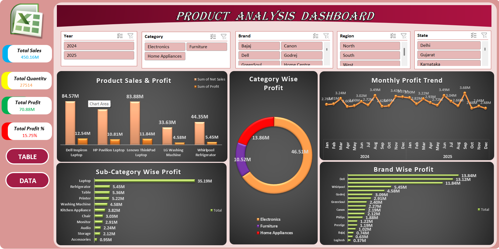

# 📊 Product Analysis Dashboard - MS Excel

An interactive and dynamic Product Analysis Dashboard built using Microsoft Excel to track Sales, Profit, and Product Performance.

### 🔗 Live Project Link
[Click here to view Excel File](https://github.com/DattatrayMasane96)

### 📸 Dashboard Preview

### 📈 Key KPIs Tracked
- **Total Sales:** 450.16M
- **Total Profit:** 70.68M
- **Profit Percentage:** 15.7%
- **Top Performing Category & Brand**

### ✨ Key Features
- **Fully Interactive:** Added slicers for Year, Category, Brand, Region, and State.
- **Dynamic Charts:**
    1. Product Sales & Profit Analysis
    2. Category Wise Profit % (Donut Chart)
    3. Monthly Profit Trend (Line/Area Chart)
    4. Sub-Category Wise Profit (Bar Chart)
    5. Brand Wise Profit Analysis
- **User-Friendly Design:** Clean UI with professional color theme and card visuals.

### 🛠️ Tools & Functions Used
- MS Excel
- Pivot Tables & Pivot Charts
- Slicers & Timelines
- Conditional Formatting
- Dashboard Designing & Data Visualization

### 💡 Key Insights
- Identified top 3 profit-generating categories.
- Analyzed monthly profit trends to find seasonality.
- Compared brand performance to optimize inventory.

### 👨‍💻 Created By
**Dattatray Masane** | Aspiring Data Analyst
- LinkedIn: [linkedin.com/in/dattatray-masane-36aab2296](https://linkedin.com/in/dattatray-masane-36aab2296)
- GitHub: [DattatrayMasane96](https://github.com/DattatrayMasane96)

---
⭐ If you like this project, give it a star!
